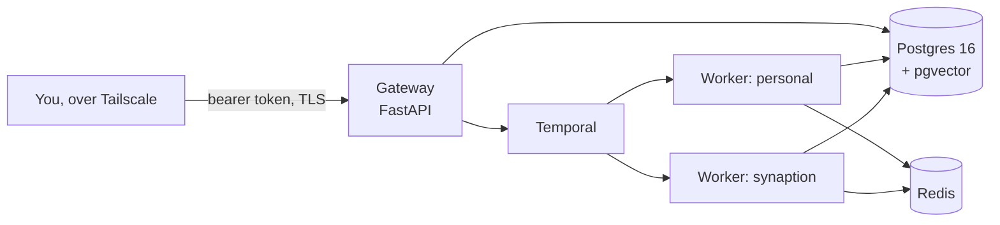

# agent-factory

A private, self-hosted multi-agent system: orchestration, memory and delegation. Agents work for one
person across two isolated spaces (`personal` and `synaption`). The model proposes actions;
deterministic code validates, authorizes, audits and executes them.

This repository is public and contains code, docs and synthetic examples only. Real configuration
lives in a separate private repository loaded through `AF_CONFIG_DIR`.

**Status:** the foundation is being built. Done so far: M0 (repository, tooling, local stack), M1
(database, space isolation, audit chain) and M3 (memory, context builder). No agents yet. See
[docs/PLAN.md](docs/PLAN.md) for the milestones and [docs/adr/](docs/adr/) for the accepted
decisions. [docs/SPEC.md](docs/SPEC.md) is the source of truth.

## Architecture



One worker process per space, each with its own Temporal namespace and task queue (ADR 0001) and,
from M1, its own database role under row-level security (ADR 0002). Every published port binds
`127.0.0.1` (ADR 0007).

## Quick start

Requires Docker with Compose v2.20+, [uv](https://docs.astral.sh/uv/) and GNU make.

```sh
make setup   # dependencies, git hooks, .env with random local passwords
make up      # build and start the stack, wait until every service is healthy
curl -s http://127.0.0.1:8000/readyz
make test-integration
make down
```

Temporal UI: http://127.0.0.1:8080.

## Development

| Target | What it does |
| --- | --- |
| `make lint` | Ruff lint and format check |
| `make typecheck` | Pyright, strict on `core/` |
| `make test` | Unit and database tests with coverage (needs Docker) |
| `make test-integration` | Tests against the running stack |
| `make migrate` | Create or update database roles, apply migrations |
| `make eval` | Placeholder until M5b |
| `make stats` | Memory and CPU per container |

Schema, roles and the audit chain: [docs/DATABASE.md](docs/DATABASE.md). Memory, embeddings and the
context builder: [docs/MEMORY.md](docs/MEMORY.md).

`core/` may import only the standard library and pydantic; a unit test enforces it. Vendor code goes
under `integrations/`, processes under `apps/`.

## License

MIT
